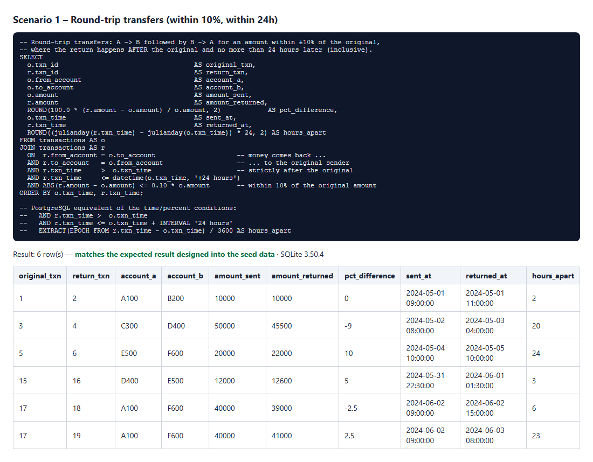
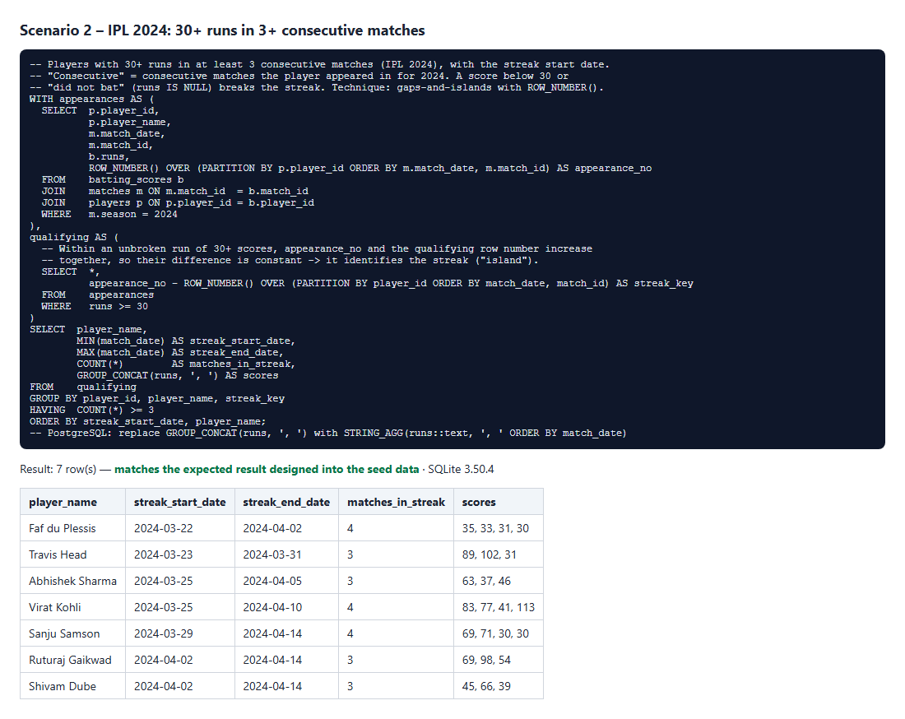

# Streamhub QA Automation Assessment: Section A

This repo contains:

* **LoanLens**, a small EMI web app with a dashboard, calculator, reports and charts
* a **Playwright + Cucumber** framework (feature files, step definitions, Page Objects, environment config)
* **API tests** for JSONPlaceholder
* **SQL** scenarios
* an **AI self-healing locator** POC

| Part | Where | Status |
|---|---|---|
| A1 Web app | [`app/`](app/) | ✅ Dashboard (KPIs and bar chart), EMI calculator (form, sliders, pie chart, yearly bar chart with tooltip, amortisation table), Reports (filters, table, totals) |
| A2 UI automation | [`features/ui`](features/ui), [`src/`](src/) | ✅ **17 scenarios / 130 steps passed** |
| A3 API tests | [`features/api`](features/api) | ✅ 22 scenarios run against the real API: 14 passed, **8 failed, and each failure is a real defect** (7 missing-validation gaps and 1 server error on malformed JSON; see [findings](#a3-api-findings)) |
| A4 SQL | [`sql/`](sql/) | ✅ Schemas, seed data, queries, and automated checks of the expected output, with screenshots |
| AI self-healing | [`SELF_HEALING.md`](SELF_HEALING.md), [`self-healing/`](self-healing/) | ✅ 5 broken locators, write-up, and a working POC (5/5 healed and validated) |
| Test results | [`results/`](results/) | HTML reports, JSON, screenshots, console logs |

---

## Setup

Requires **Node.js 22.13 or later**. The SQL runner uses the built-in `node:sqlite`; everything else works on Node 18 or later.

```bash
git clone <repo-url> && cd streamhub-qa-assessment
npm install
npx playwright install chromium
```

## How to run

| Command | What it does |
|---|---|
| `npm start` | Runs the app at http://localhost:3000 |
| `npm run test:ui` | UI suite. The app starts automatically. Report: `results/ui/cucumber-report.html` |
| `npm run test:api` | API suite against the **real** `https://jsonplaceholder.typicode.com`. Report: `results/api/` |
| `npm run test:api:mock` | Same API suite against a local JSONPlaceholder look-alike, for offline use |
| `npm test` | UI suite, then API suite |
| `npm run test:broken` | Runs the intentionally broken locators (**expected to fail**) |
| `npm run heal` | Self-healing POC. Set `ANTHROPIC_API_KEY` to use Claude; without it, an offline heuristic is used |
| `npm run report:summary` | Prints a PASS/FAIL list for each scenario from the JSON reports |
| `npm run sql` | Runs both SQL scenarios, asserts the output, and writes text and PNG to `results/sql/` |

Run a subset by tag: `npx cucumber-js --profile ui --tags @calculator`

### Environment configuration (no hard-coded URLs)
All URLs and settings come from `config/env/<TEST_ENV>.env` through [`config/config.js`](config/config.js):

```bash
TEST_ENV=local   npm run test:ui    # default: starts the app on localhost
TEST_ENV=staging npm run test:ui    # points at a deployed app, does not start a server
TEST_ENV=mock    npm run test:api   # offline API mock
```
Settings: `BASE_URL`, `API_BASE_URL`, `HEADLESS`, `BROWSER` (chromium/firefox/webkit), `DEFAULT_TIMEOUT_MS`, `SCREENSHOT_ON` (always/failure/never), and optionally `BROWSER_EXECUTABLE_PATH`. Real environment variables override the file.

---

## Architecture

```
app/                       A1 – LoanLens web app (zero-dependency Node server + vanilla JS, SVG charts)
  server.js                static files + GET /api/loans?type=&status=
  data/loans.json          mock portfolio data
config/
  config.js                loads config/env/<TEST_ENV>.env, validates required keys
  env/local.env | staging.env | mock.env
features/
  ui/*.feature             dashboard, emi-calculator, reports, self-healing (@broken-locators)
  api/create-post.feature  A3 JSONPlaceholder boundary/invalid data
src/
  pages/                   Page Objects (BasePage, DashboardPage, CalculatorPage, ReportsPage)
  pages/legacy/            BrittleCalculatorPage – intentionally broken locators
  steps/                   step definitions (thin: call page objects, assert)
  api/                     PostsApi service object, payload builders, local API mock
  support/world.js         Cucumber World: lazy page objects, scenario context
  support/hooks.js         start app/mock, browser per scenario, screenshots attached to report
  utils/emiCalculator.js   independent EMI oracle (does NOT import app code)
  utils/parse.js           ₹ / "25L" parsing
sql/                       A4 – schema, seed, query per scenario + run-sql.js (asserts and screenshots)
self-healing/              AI self-healing POC (heal.js, prompt.js)
scripts/                   summarise-results.js (PASS/FAIL list from Cucumber JSON)
results/                   committed execution evidence
```

**Design decisions**
* **Layers:** feature (business language) → steps (glue and assertions) → page objects (locators and UI actions). A markup change touches one page object, not the tests.
* **Locators:** `getByRole` with accessible names, `getByLabel`, and `getByTestId` only. There are no positional CSS or XPath selectors outside the intentional `legacy/` folder. Charts are SVGs with `role="img"` and an `aria-label`, so they are accessible and easy to test.
* **Independent oracle:** `src/utils/emiCalculator.js` implements `EMI = P·r·(1+r)^n / ((1+r)^n − 1)` on its own and never imports the app's code. Displayed values are compared within a ±₹1 rounding tolerance. Dashboard and report expectations are calculated from the raw `/api/loans` data, not from the UI.
* **Web-first assertions:** `expect` from `@playwright/test` auto-waits, so there are no fixed sleeps.
* **Isolation:** each scenario gets a new browser context. Screenshots are attached to the HTML report and saved to `results/screenshots`.

### What the UI suite covers (A2)
* **Navigation:** the dashboard loads, the correct nav link is active, and all KPI tiles show values.
* **Calculations:** EMI, total interest and total payment match the independent calculation for Home loan A (25L, 10%, 10y → **₹33,038**), Home loan B (50L, 7.5%, 15y → **₹46,351**), a personal loan (10L, 12%, 5y → **₹22,244**) and a small edge case. The sliders path is also covered.
* **Charts:** the pie chart is visible, has 2 slices that are both above zero (both value and rendered size), and the slices equal the principal and the interest. The yearly bar chart has one bar per year, and the hover **tooltip** values match the independently calculated schedule. On the dashboard, the bar chart's values are above zero and add up to the Total principal tile.
* **Reports:** filters return only matching rows, the same loans as the API returns, and correct totals.
* **Negative cases:** zero amount, rate above 30%, and fractional tenure are rejected with a message and no result is shown.

**Proving the tests can fail:** I temporarily broke the app's EMI formula (+₹5 and +1% interest). The suite then failed the dashboard, EMI and tooltip checks. I reverted the change afterwards.

---

## A3 API findings

The suite checks POST `/posts` with long titles (256 to 1,000,000 characters), 9 kinds of special or unsupported characters (emoji, RTL/CJK text, SQL and HTML injection, control characters, null byte, zero-width characters), 7 invalid payloads, and malformed JSON.

Each test has two levels of assertion:
1. **Hard requirement:** the API must never return a 5xx, and an accepted title must come back exactly as sent, without truncation or corruption.
2. **Expected outcome from the brief:** invalid input should be rejected with a **4xx and an error message**.

**Result against the real `https://jsonplaceholder.typicode.com`: 22 scenarios, 14 passed, 8 failed.** The report is in `results/api/` and the PASS/FAIL list is in `results/console/api-scenarios.txt`.

| # | Defect | Request | Expected | Actual | Severity |
|---|---|---|---|---|---|
| 1 | **Malformed JSON crashes the server** | Body `{"title": "broken", "userId": 1,` | 400 Bad Request | **500 Internal Server Error** | **High**: a server-side failure on bad input is exactly what the brief says must not happen |
| 2 | Missing required `userId` accepted | `{title, body}` | 400 + message | 201 Created | Medium |
| 3 | Missing `title` accepted | `{body, userId}` | 400 + message | 201 Created | Medium |
| 4 | Missing `body` accepted | `{title, userId}` | 400 + message | 201 Created | Medium |
| 5 | Empty object accepted | `{}` | 400 + message | 201 Created (`{"id":101}`) | Medium |
| 6 | Wrong type accepted | `userId: "abc"` | 400/422 | 201 Created | Medium |
| 7 | Out-of-range value accepted | `userId: -1` | 400/422 | 201 Created | Medium |
| 8 | Null title accepted | `title: null` | 400/422 | 201 Created | Medium |

**What passed (14):** a valid post is created (201, all fields echoed, numeric `id`). Long titles of 256, 10,000, 100,000 and **1,000,000 characters** were all accepted with no 5xx and no truncation. All 9 special-character cases (emoji, multi-language text, SQL injection, HTML/script injection, quotes and backslashes, control characters, null byte, zero-width/RTL marks, JSON-breaking characters) came back exactly as sent.

**Observations:**
* JSONPlaceholder is a fake API by design, so findings 2–8 are expected behaviour for it. The tests still report them, because the brief defines the expected outcome as "appropriate HTTP error codes or error messages for invalid inputs". In a real project each would be raised as a bug, for example "POST /posts accepts a payload without the required userId – expected 400".
* There is **no upper limit on title length**. A 1 MB title is accepted. That isn't a 5xx, so it passes, but in a real API it would be worth raising: a 413 or a length validation would be expected.
* The full run takes about 1 minute, mostly because of the large-payload uploads.

> **Offline mock:** `npm run test:api:mock` (`TEST_ENV=mock`) runs the same suite against a local look-alike in `src/api/mockJsonPlaceholder.js`. I built it because the build sandbox could not reach jsonplaceholder.typicode.com. The mock first *assumed* that malformed JSON returns 400. The real run showed a **500**, so the mock was corrected to match what the real server does. The real results in `results/api/` are the evidence; `results/api-mock/` only shows that the framework runs offline.

---

## A4 SQL

Both scenarios use SQLite 3.25 or later (window functions). Notes for PostgreSQL are in the query files. Each folder has `01_schema.sql`, `02_seed.sql` and `03_query.sql`. `npm run sql` runs both and **asserts** that the output matches the expected rows designed into the seed data. Screenshots are in [`results/sql/`](results/sql/).

**Scenario 1: round-trip transfers.** A self-join where `r.from = o.to AND r.to = o.from`, the return happens strictly after the original and no more than 24 hours later (inclusive), and `|r.amount − o.amount| ≤ 10% of o.amount`. The seed data has one case per rule: match, 9% lower, exactly 10% and exactly 24h, 15% lower, 24h plus 1 minute, same direction, money passed to a third account, crossing midnight and month end, and two returns for one transfer.


**Scenario 2: IPL 2024 streaks.** Uses the gaps-and-islands technique. `ROW_NUMBER()` over all of a player's 2024 appearances, minus `ROW_NUMBER()` over only their 30+ innings, is constant within an unbroken streak. Grouping by that value and keeping `HAVING COUNT(*) >= 3` gives each streak and its start date.
*Assumptions:* "30+" means `runs >= 30`. "Consecutive" means consecutive matches **the player appeared in**. "Did not bat" (`NULL`) breaks a streak. Only the 2024 season counts; a 2023 streak in the seed data is correctly ignored.


---

## Test results (`results/`)

| Suite | Result | Evidence |
|---|---|---|
| UI | 17/17 scenarios, 130/130 steps passed | `results/ui/cucumber-report.html`, `results/screenshots/`, `results/console/ui-scenarios.txt` |
| API (real JSONPlaceholder) | 14 passed, 8 failed (8 documented defects, including a 500 on malformed JSON) | `results/api/cucumber-report.html`, `results/console/api-scenarios.txt` |
| Broken locators | 1 scenario failed, as intended, on the first broken locator | `results/broken/`, `results/screenshots/FAILED-*.png` |
| Self-healing POC | 5/5 healed and validated | `results/self-healing/healing-report.md`, `suggested-fixes.patch` |
| SQL | 2/2 scenarios match the expected output | `results/sql/*.png`, `*.txt` |

---

## Claude Code reflection

**How I used it.** I used Claude as a pair programmer for the whole assessment. I described the framework in plain language: Cucumber features, a separate steps layer, Page Objects, env-based config, an app with a dashboard, calculator and reports, and SQL with window functions. Claude scaffolded the structure and the first versions of the code. I then iterated with it on scenarios, edge cases, the self-healing design and the SQL seed data. I also used it to explain APIs I was less familiar with: `locator.ariaSnapshot()`, how `getByRole` works with SVG `role="img"`, and the gaps-and-islands pattern.

**What worked well**
* Scaffolding was fast, and the layering was consistent across features, steps, pages and config.
* **Automated checks caught AI mistakes**, which is the main lesson from this project:
  * *SQL:* one designed test case ("the return happened before the original") was wrong. Any A→B / B→A pair within 24 hours *is* a round trip, with the earlier transaction as the original. The output assertion in `run-sql.js` failed, and the test data was fixed, not the query.
  * *UI:* every functional check passed on the first run, but the **screenshots** showed misaligned columns in the amortisation table and results tiles touching the form. A broad CSS `nth-child` rule was the cause, and it was fixed. Functional tests alone would have missed this.
  * *Tests that can't fail are worthless:* I asked for a deliberate bug in the app's EMI formula to prove the suite goes red. It did.
* Writing the self-healing prompt as **strict JSON with an allow-list of strategies** came out of discussing hallucinated selectors. The model's job is reduced to choosing an element, and code builds the locator.

**What did not work, or needed correction**
* The first draft of the API tests expected JSONPlaceholder to return 400 for invalid data. It is a fake API that returns 201 for everything. I split the assertions into "never 5xx" (hard) and "should be 4xx" (documented findings) so the report is honest and not just red.
* Environment problems: the Playwright version did not match the browser installed in the sandbox (solved with the optional `BROWSER_EXECUTABLE_PATH`), and jsonplaceholder.typicode.com was blocked from the build sandbox. That is why there is a mock-API environment and the evidence note above.
* **A mock is only as good as its assumptions.** The offline JSONPlaceholder mock assumed malformed JSON would get a 400. The first run against the real API returned a **500**, which is the most important API finding. I corrected the mock and now treat the real-API run as the only evidence.
* Deprecated options were suggested, such as Cucumber's `publishQuiet`, and had to be removed.
* AI-generated validation can be too weak. The self-healing "shows a ₹ amount" check would also pass for the wrong tile. I documented this as a known limitation instead of overstating the POC.

**My takeaway.** AI made me much faster on boilerplate and unfamiliar APIs. Correctness still came from independent oracles, output assertions, screenshots, and reviewing what it produced.
